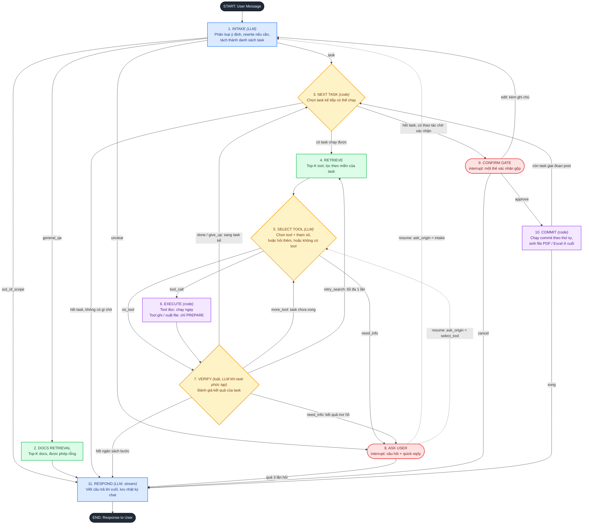

# Agent Graph v2: thiết kế nâng cấp từ graph 11 node hiện tại

> Ngày dùng trong ví dụ: **Chủ nhật 01/11/2026**. "Hôm qua" = 31/10, "tuần này" = 26/10 đến 01/11, thứ 3 tuần này = 27/10.

## 1. Ý tưởng chính của v2

Giữ khung 11 node bạn đang có, nhưng đổi vai trò để mỗi node có **đúng một trách nhiệm** và luồng dữ liệu có thể đoán trước.

| # | Thay đổi | Lý do |
|---|---|---|
| 1 | **Intake làm luôn việc của Planner**: phân loại ý định, rewrite khi cần, tách thành danh sách task | Không thêm node và không thêm lần gọi LLM |
| 2 | **Bỏ node `rewrite` riêng**. Khi tìm tool hụt, `select_tool` trả `search_hint` để `retrieve` tìm lại | Bớt một node, bớt một lần gọi LLM |
| 3 | **Gộp `eval_tool` + `eval_no_tool` thành `verify`**, chạy bằng **luật (code) trước**, LLM chỉ khi task phức tạp | Hết hai bộ đánh giá chồng chéo; đường chạy chính ít gọi LLM hơn |
| 4 | **`retrieve` lọc tool theo miền** (hồ sơ / dinh dưỡng / luyện tập) | Model 14B chọn tool đúng hơn khi chỉ thấy 5 tool cùng miền |
| 5 | **Thêm `next_task`** (code): xử lý lần lượt nhiều task | Hỗ trợ câu nhiều việc |
| 6 | **Tool ghi chỉ `prepare` ở `execute`**, xác nhận **một lần ở cuối**, rồi mới `commit` | Không ghi dữ liệu trước khi xác nhận |
| 7 | **Thêm node `commit`** (code) | Chỗ duy nhất được phép ghi dữ liệu và sinh file |
| 8 | **`ask_user` quay về đúng nơi đã hỏi** (`ask_origin`) | Không mất tiến độ sau khi người dùng trả lời |
| 9 | **Bộ đếm chống vòng lặp** kiểm tra trong các hàm `route_*` | Không bao giờ chạy vô hạn, luôn kết thúc bằng một câu trả lời |
| 10 | **Checkpointer persistent** thay `MemorySaver` | Resume không mất khi restart hoặc chạy nhiều worker |

**Số lần gọi LLM trên đường chạy chính** (câu đọc dữ liệu đơn giản): `intake` + `select_tool` + `respond` = **3 lần**. Các node còn lại là code.

---

## 2. Sơ đồ (Mermaid)



**Màu:** xanh dương = LLM viết/phân tích, xanh lá = retrieval, vàng = quyết định, tím = thực thi code, đỏ = chờ người dùng.

---

## 3. Output của từng node (ngắn gọn)

| # | Node | Loại | Output chính |
|---|---|---|---|
| 1 | INTAKE | LLM | `IntakeResult { intent, rewritten_query, tasks[], clarify_question?, options[] }` |
| 2 | DOCS RETRIEVAL | embedding | `docs[]` (có thể rỗng) |
| 3 | NEXT TASK | code | `current_task` (đã reset bộ đếm của task) hoặc quyết định đi tiếp: xác nhận / trả lời |
| 4 | RETRIEVE | embedding | `candidate_tools[]`: 5 tool cùng miền (10 khi retry) |
| 5 | SELECT TOOL | LLM | một trong ba: `ToolCall { tool, args }` / `NeedInfo { question, options }` / `NoTool { reason, search_hint }` |
| 6 | EXECUTE | code | `ToolResult { ok, data \| error, ambiguous?, truncated? }`; tool ghi thì thêm `StagedAction` |
| 7 | VERIFY | luật (+LLM) | `Verdict`: `done` / `more_tool` / `retry_search` / `need_info` / `give_up` |
| 8 | ASK USER | interrupt | `user_answer` (nút hoặc chữ), được gộp vào `current_task.context` hoặc câu truy vấn |
| 9 | CONFIRM GATE | interrupt | `decision { approve \| edit \| cancel, approved_action_ids[], note? }` |
| 10 | COMMIT | code | `commit_results[{action_id, ok, error?}]`, `files[]` |
| 11 | RESPOND | LLM | Câu trả lời cuối (stream), ghi vào nhật ký chat |

### Schema rút gọn

```python
class Task(BaseModel):
    id: str                                   # "t1"
    domain: Literal["profile", "nutrition", "workout"]
    kind: Literal["read", "write", "export"]
    goal: str                                 # 1 câu tiếng Việt, đã có ngày cụ thể
    depends_on: list[str] = []
    phase: Literal["pre", "post"] = "pre"     # post = chỉ chạy sau khi commit xong
    complex: bool = False                     # True nếu cần > 1 lần gọi tool (so sánh, tổng hợp)

class IntakeResult(BaseModel):
    intent: Literal["task", "general_qa", "out_of_scope", "unclear"]
    rewritten_query: str
    tasks: list[Task] = []                    # tối đa 5, chỉ khi intent == "task"
    clarify_question: str | None = None
    options: list[str] = []

class SelectResult(BaseModel):
    action: Literal["tool_call", "need_info", "no_tool"]
    tool: str | None = None
    args: dict = {}
    question: str | None = None
    options: list[str] = []
    search_hint: str | None = None            # khi no_tool: từ khóa tìm lại tool
```

### Luật của VERIFY (chạy bằng code, theo thứ tự)

1. Hết ngân sách bước của lượt hoặc của task thì trả về `RESPOND` (báo phần đã làm, phần chưa làm).
2. `NoTool` và `retry_count < 1` thì `retry_search` (dùng `search_hint`, K tăng lên 10). Nếu đã retry rồi thì `give_up`.
3. `ToolResult.ambiguous` có nhiều kết quả khớp thì `need_info` (code tạo sẵn `options` từ các kết quả khớp).
4. Lỗi `validation` (sai tham số) thì `more_tool` kèm nội dung lỗi để `select_tool` sửa; lỗi `system` thì `give_up`.
5. `ok` + `kind` là `read`, `write` hoặc `export` thì `done` (kể cả khi đọc ra rỗng; `respond` sẽ nói "chưa có dữ liệu").
6. Chỉ khi `task.complex == true` mới hỏi LLM "đã đủ dữ liệu chưa?" để chọn `done` hoặc `more_tool`.

---

## 4. Ví dụ luồng chạy

Quy ước: `[node] → output`. Số trong ngoặc là lần gọi LLM.

### Câu A: hỏi đáp chung
**"TDEE là gì?"**
1. `[INTAKE]` → `intent=general_qa`, `rewritten_query="TDEE là gì?"` *(LLM 1)*
2. `[DOCS RETRIEVAL]` → `docs=[]` (chưa có docs thì rỗng)
3. `[RESPOND]` → giải thích TDEE bằng kiến thức của model *(LLM 2)*

Đường đi: INTAKE → DOCS → RESPOND. Không gọi tool, không retrieve tool.

### Câu B: đọc dữ liệu đơn giản
**"Hôm qua tôi ăn gì?"**
1. `[INTAKE]` → `intent=task`, `tasks=[t1: nutrition/read, goal="Xem các bữa ăn ngày 31/10/2026"]` *(LLM 1)*
2. `[NEXT TASK]` → `current_task=t1`
3. `[RETRIEVE]` → `candidate_tools=[list_meal_logs, get_meal_log, ...]` (chỉ tool nhóm dinh dưỡng)
4. `[SELECT TOOL]` → `ToolCall{list_meal_logs, {date: "2026-10-31"}}` *(LLM 2)*
5. `[EXECUTE]` → `ToolResult{ok, data: 4 bữa ăn}`
6. `[VERIFY]` → `done` (luật 5)
7. `[NEXT TASK]` → hết task, không có gì chờ xác nhận
8. `[RESPOND]` → "Hôm qua bạn ăn: ..." *(LLM 3)*

Đường đi: INTAKE → NEXT TASK → RETRIEVE → SELECT TOOL → EXECUTE → VERIFY → NEXT TASK → RESPOND.

### Câu C: thêm dữ liệu, thiếu thông tin
**"Ghi giúp tôi bữa vừa rồi: phở bò"**
1. `[INTAKE]` → `tasks=[t1: nutrition/write, goal="Thêm bữa ăn 'phở bò' hôm nay"]`
2. `[NEXT TASK]` → `[RETRIEVE]` → `candidate_tools=[prepare_create_meal_log, ...]`
3. `[SELECT TOOL]` → `NeedInfo{question: "Đây là bữa nào?", options: [Sáng, Trưa, Tối, Ăn vặt]}`
4. `[ASK USER]` (interrupt, `ask_origin=select_tool`) → giao diện hiện 4 nút; người dùng bấm **Trưa** → `user_answer="Trưa"`
5. Resume về `[SELECT TOOL]` → `ToolCall{prepare_create_meal_log, {name: "phở bò", meal_type: "lunch", date: "2026-11-01"}}`
6. `[EXECUTE]` → chỉ chuẩn bị: `StagedAction{preview: "Thêm bữa trưa hôm nay: phở bò", risk: low, affected_count: 1}`, chưa ghi database
7. `[VERIFY]` → `done`
8. `[NEXT TASK]` → hết task, có thao tác chờ xác nhận → `[CONFIRM GATE]`: thẻ "Thêm bữa trưa hôm nay: phở bò" → người dùng bấm **Xác nhận**
9. `[COMMIT]` → `commit_results=[{a1, ok}]`
10. `[RESPOND]` → "Đã thêm bữa trưa: phở bò."

Đường đi: ... SELECT TOOL → ASK USER → SELECT TOOL → EXECUTE → VERIFY → NEXT TASK → CONFIRM GATE → COMMIT → RESPOND.

### Câu D: nhiều việc, có xuất file
**"Xóa buổi tập ngày 27/10 và xuất thực đơn tuần này ra Excel"**
1. `[INTAKE]` → `tasks=[t1: workout/write "Xóa buổi tập 27/10", t2: nutrition/export "Xuất thực đơn 26/10 đến 01/11 ra Excel"]`
2. Task `t1`: `NEXT TASK → RETRIEVE → SELECT TOOL → EXECUTE → VERIFY`
   - `EXECUTE` → `StagedAction a1{preview: "Xóa 1 buổi tập ngày 27/10", risk: high, affected_count: 1}`
3. Task `t2`: lặp lại vòng trên với tool nhóm dinh dưỡng và tool tệp
   - `EXECUTE` → `StagedAction a2{preview: "Xuất thực đơn tuần này ra file Excel", risk: low}`; chỉ lưu tham số, **chưa tạo file**
4. `[NEXT TASK]` → hết task → `[CONFIRM GATE]`: **một thẻ** hai dòng (a1, a2), người dùng bấm Xác nhận cả hai
5. `[COMMIT]` → chạy theo thứ tự: xóa buổi tập trước, **sinh file sau cùng** → `files=[thuc-don-tuan.xlsx]`
6. `[RESPOND]` → "Đã xóa buổi tập 27/10 và xuất file thực đơn: (link tải)."

### Câu E: xóa hàng loạt, người dùng hủy
**"Xóa hết nhật ký ăn uống của tôi"**
1. `[INTAKE]` → `tasks=[t1: nutrition/write]`
2. `... [EXECUTE]` → `StagedAction{preview: "Xóa toàn bộ 120 bản ghi nhật ký ăn uống. Không thể hoàn tác.", risk: high, affected_count: 120}`
3. `[CONFIRM GATE]` → thẻ nổi bật mức rủi ro cao → người dùng bấm **Hủy** → `decision=cancel`
4. `[RESPOND]` → "Mình chưa xóa gì cả."

Đường đi: ... CONFIRM GATE → RESPOND. **Không qua COMMIT**, dữ liệu nguyên vẹn.

### Câu F: tìm tool hụt rồi tìm lại
**"Tuần qua tôi nạp bao nhiêu kcal?"** (từ "nạp" khiến Top-K lần đầu không chứa tool phù hợp)
1. `[RETRIEVE]` (K=5) → `candidate_tools` không có tool tính tổng calo
2. `[SELECT TOOL]` → `NoTool{search_hint: "tổng calo theo ngày nhật ký ăn uống"}`
3. `[VERIFY]` → `retry_search` (luật 2, `retry_count` 0 thành 1)
4. `[RETRIEVE]` (K=10, dùng `search_hint`) → có `summarize_meal_logs`
5. `[SELECT TOOL]` → `ToolCall{summarize_meal_logs, {from: "2026-10-26", to: "2026-11-01"}}`
6. `[EXECUTE] → [VERIFY]` → `done` → `[RESPOND]`

Nếu lần retry vẫn không có tool: `VERIFY → give_up` → task đánh dấu `failed` → `RESPOND` nói thật: "Mình chưa có chức năng này."

### Câu G: ý định chưa rõ và ngoài phạm vi
**"Làm cái đó đi"**
1. `[INTAKE]` → `intent=unclear`, `clarify_question="Bạn muốn mình làm gì?"`, `options=[Xem nhật ký ăn, Xem lịch tập, Cập nhật hồ sơ]`
2. `[ASK USER]` (`ask_origin=intake`) → người dùng bấm "Xem lịch tập"
3. Resume về `[INTAKE]` (câu truy vấn đã gộp câu trả lời) → `intent=task` → đi tiếp như câu B

**"Hôm nay thời tiết thế nào?"**
- `[INTAKE]` → `intent=out_of_scope` → `[RESPOND]` từ chối nhẹ nhàng, gợi ý những việc agent làm được.

### Câu H: đọc sau khi ghi (phase post)
**"Xóa bữa tối hôm qua rồi cho tôi xem hôm qua còn ăn gì"**
1. `[INTAKE]` → `tasks=[t1: nutrition/write "Xóa bữa tối 31/10" (phase pre), t2: nutrition/read "Xem các bữa ăn 31/10" (phase post, depends_on t1)]`
2. `[NEXT TASK]` chỉ chạy task `phase=pre`: `t1` tới `StagedAction`
3. `[CONFIRM GATE]` → Xác nhận → `[COMMIT]` (xóa thật)
4. `COMMIT → NEXT TASK` (còn task `post`) → `t2` chạy đọc dữ liệu **sau khi xóa**
5. `[NEXT TASK]` → hết task → `[RESPOND]`: "Đã xóa bữa tối. Hôm qua bạn còn: sáng ..., trưa ..."

Nếu không có `post`, `t2` sẽ đọc dữ liệu cũ (chưa xóa) và trả lời sai. Đây là lý do cần `phase`.

### Câu I: sửa trước khi xác nhận
Ở Câu C, nếu người dùng bấm **Sửa** và nhập "đổi thành bữa tối":
- `[CONFIRM GATE]` → `decision=edit, note="đổi thành bữa tối"` → xóa `staged_actions`, `edit_count += 1`
- Quay về `[INTAKE]` với ghi chú đã gộp vào câu truy vấn → tạo lại kế hoạch → luồng chạy lại như Câu C, lần này `meal_type=dinner`.

---

## 5. Bộ đếm và giới hạn

| Biến trong state | Giới hạn | Kiểm tra ở | Vượt giới hạn |
|---|---|---|---|
| `total_steps` (số lần `select_tool` mỗi lượt) | 12 | `route_after_verify` | Về `respond`, báo phần đã làm |
| `task_steps[task_id]` | 4 | `verify` (luật 1) | `give_up` task |
| `retry_count[task_id]` | 1 | `verify` (luật 2) | `give_up` task |
| `ask_count` | 3 | `route_after_ask_user` | Về `respond`, nói rõ còn thiếu gì |
| `edit_count` | 2 | `route_after_confirm_gate` | Về `respond`, đề nghị bắt đầu lại |
| Parse structured output hỏng | 2 lần | `intake`, `select_tool` | `intake` coi là `unclear`; `select_tool` coi là `no_tool` |
| Hạn chờ xác nhận | 30 phút | `confirm_gate` | Coi như Hủy |

Nguyên tắc: mọi vòng lặp đều có bộ đếm, và hết giới hạn thì **luôn đi về `respond`**, không bao giờ để chạm `recursion_limit`.

---

## 6. State bổ sung (so với graph hiện tại)

```python
class AgentState(TypedDict):
    # định danh: backend gán, LLM không chạm được
    user_id: int
    thread_id: str
    today: str                      # "2026-11-01", đưa vào prompt Intake để hiểu "hôm qua", "tuần này"

    messages: list
    rewritten_query: str
    intent: str
    docs: list[dict]

    tasks: list[Task]
    task_status: dict[str, str]     # pending | running | prepared | done | failed
    current_task_id: str | None
    phase: Literal["pre", "post"]
    candidate_tools: list[dict]
    last_result: dict | None

    staged_actions: list[StagedAction]
    approved_action_ids: list[str]
    commit_results: list[dict]
    files: list[dict]

    ask_origin: Literal["intake", "select_tool"] | None
    edit_note: str | None
    total_steps: int
    task_steps: dict[str, int]
    retry_count: dict[str, int]
    ask_count: int
    edit_count: int
    final_answer: str
```

---

## 7. Hàm định tuyến (`route_*`)

| Hàm | Đọc từ state | Trả về |
|---|---|---|
| `route_after_intake` | `intent` | `next_task` / `docs_retrieval` / `ask_user` / `respond` |
| `route_after_next_task` | task còn lại, `staged_actions`, `phase` | `retrieve` / `confirm_gate` / `respond` |
| `route_after_select_tool` | `SelectResult.action` | `execute` / `ask_user` / `verify` |
| `route_after_verify` | `Verdict`, `total_steps` | `next_task` / `select_tool` / `retrieve` / `ask_user` / `respond` |
| `route_after_ask_user` | `ask_origin`, `ask_count` | `intake` / `select_tool` / `respond` |
| `route_after_confirm_gate` | `decision`, `edit_count` | `commit` / `intake` / `respond` |
| `route_after_commit` | còn task `post` không | `next_task` / `respond` |

### Khung dựng graph

```python
def build_agent_graph_v2(checkpointer):
    g = StateGraph(AgentState)

    g.add_node("intake", intake_node)
    g.add_node("docs_retrieval", docs_retrieval_node)
    g.add_node("next_task", next_task_node)
    g.add_node("retrieve", retrieve_tools_node)
    g.add_node("select_tool", select_tool_node)
    g.add_node("execute", execute_node)
    g.add_node("verify", verify_node)
    g.add_node("ask_user", ask_user_node)
    g.add_node("confirm_gate", confirm_gate_node)
    g.add_node("commit", commit_node)
    g.add_node("respond", respond_node)

    g.add_edge(START, "intake")
    g.add_conditional_edges("intake", route_after_intake, {
        "next_task": "next_task", "docs_retrieval": "docs_retrieval",
        "ask_user": "ask_user", "respond": "respond"})
    g.add_edge("docs_retrieval", "respond")
    g.add_conditional_edges("next_task", route_after_next_task, {
        "retrieve": "retrieve", "confirm_gate": "confirm_gate", "respond": "respond"})
    g.add_edge("retrieve", "select_tool")
    g.add_conditional_edges("select_tool", route_after_select_tool, {
        "execute": "execute", "ask_user": "ask_user", "verify": "verify"})
    g.add_edge("execute", "verify")
    g.add_conditional_edges("verify", route_after_verify, {
        "next_task": "next_task", "select_tool": "select_tool", "retrieve": "retrieve",
        "ask_user": "ask_user", "respond": "respond"})
    g.add_conditional_edges("ask_user", route_after_ask_user, {
        "intake": "intake", "select_tool": "select_tool", "respond": "respond"})
    g.add_conditional_edges("confirm_gate", route_after_confirm_gate, {
        "commit": "commit", "intake": "intake", "respond": "respond"})
    g.add_conditional_edges("commit", route_after_commit, {
        "next_task": "next_task", "respond": "respond"})
    g.add_edge("respond", END)

    return g.compile(checkpointer=checkpointer)
```

**Quy tắc cho node có `interrupt`** (`ask_user`, `confirm_gate`): khi resume, node chạy lại từ đầu, nên mọi việc trước `interrupt` trong node đó không được ghi database hay gửi gì ra ngoài. Việc ghi chỉ nằm ở `commit`.

---

## 8. Lộ trình nâng từ graph hiện tại lên v2

Làm theo thứ tự, mỗi bước chạy và test được trước khi sang bước sau.

1. **Sửa an toàn trước, không đổi hình dạng graph:** thêm node `commit`, bảo đảm `execute_tool` với tool ghi chỉ prepare, thêm bộ đếm trong các hàm `route_*`, bắt exception trong `execute`, thay `MemorySaver` bằng checkpointer persistent.
2. **Gộp hai evaluator thành `verify`** theo luật ở mục 3, giữ nguyên các node còn lại.
3. **Bỏ node `rewrite`:** Intake rewrite theo ngữ cảnh, `select_tool` trả `search_hint`, `retrieve` đọc `retry_count`.
4. **Lọc tool theo miền ở `retrieve`:** Intake trả `domain`, `retrieve` chỉ lấy tool của miền đó.
5. **Thêm `tasks[]` và `next_task`:** Intake tách task, graph chạy tuần tự; xác nhận gộp một lần ở cuối.
6. **Thêm `phase` pre/post** cho câu đọc sau khi ghi (Câu H) và nhánh "Sửa" (Câu I).
7. **Thêm tool tệp** (prepare ở `execute`, sinh file ở `commit`).

### Checklist nghiệm thu nhanh
- Câu A đến I đều đi đúng đường như mục 4 (viết mỗi câu thành một test, kiểm tra thứ tự node bằng stream `updates`).
- Không có thao tác ghi nào xảy ra trước khi `decision=approve`.
- Cố tình làm `select_tool` luôn trả `no_tool`: graph phải dừng sau tối đa 1 lần retry, không lặp.
- Tắt server giữa lúc chờ xác nhận, bật lại rồi bấm Xác nhận: vẫn commit đúng.
