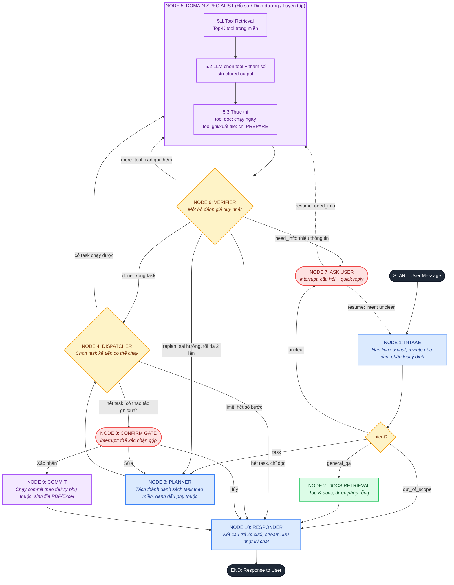

# AI Agent dinh dưỡng & luyện tập: Flow mới + Requirements

> Tài liệu này dùng để nâng cấp agent hiện có (Python, LangChain, LangGraph). Làm theo từng Phase ở mục 12, không làm tất cả một lần.

---

## 0. Sơ đồ flow (Mermaid)



**Chú giải màu:** xanh dương = xử lý LLM, xanh lá = retrieval, vàng = quyết định/định tuyến, tím = thực thi tool, đỏ = điểm chờ người dùng.

### Bảng ánh xạ từ flow cũ sang flow mới

| Flow cũ | Flow mới | Ghi chú |
|---|---|---|
| Node 1 Rewrite | Node 1 Intake | Rewrite chỉ khi cần; không còn là đường sửa lỗi chung |
| Node 2.1 Tool Retrieval | 5.1 trong Specialist | Lọc Top-K sau khi đã biết miền |
| Node 2.2 Doc Retrieval | Node 2 Docs Retrieval | Chỉ chạy với general_qa; được phép rỗng |
| Node 3 Router Agent | Intake (phân loại) + 5.2 (chọn tool) | Tách làm hai việc nhỏ |
| Node 4.1 Execute Tool | 5.3 và Node 9 Commit | Tool ghi tách prepare/commit |
| Node 5.1 + 5.2 Evaluator | Node 6 Verifier | Gộp thành một, bỏ các mũi tên chéo |
| Node 6 Generative Result | Node 10 Responder | Giữ nguyên vai trò |
| (chưa có) | Node 3, 4, 7, 8 | Planner, Dispatcher, Ask User, Confirm Gate |

---

## 1. Mục tiêu và phạm vi

### Mục tiêu
1. Người dùng nhắn tin để agent làm thay các thao tác CRUD mà trước đây phải click qua nhiều trang.
2. Agent trò chuyện hai chiều: hỏi lại khi thiếu thông tin, đưa lựa chọn nhanh, xin xác nhận trước khi thay đổi dữ liệu.
3. Agent trả lời hỏi đáp thông thường.
4. Agent xuất file PDF và Excel (dạng chữ) cho người dùng tải về.
5. Kiến trúc rõ ràng: mỗi node một trách nhiệm, không có mũi tên chéo giữa các bộ đánh giá.

### Ngoài phạm vi (làm sau hoặc không làm)
- Ảnh, biểu đồ, file ảnh.
- Tư vấn y tế (đã xác nhận không cần xử lý riêng).
- Docs kiến thức thật (chỉ chừa chỗ, xem mục 3 Node 2).
- Gọi LLM qua API bên ngoài (dùng local).

### Nhóm dữ liệu người dùng
`thông tin cá nhân` (hồ sơ), `nhật ký ăn uống`, `nhật ký tập luyện`, `nhật ký chat`.

---

## 2. Ràng buộc kỹ thuật

| Hạng mục | Quyết định |
|---|---|
| Ngôn ngữ / framework | Python, LangChain, LangGraph |
| Database | MariaDB, truy vấn bằng SQLAlchemy |
| LLM | Local 14B, không dùng API; chấp nhận chạy chậm để lấy chiều sâu |
| Embedding | Model HuggingFace nhỏ, chạy local |
| Streaming | Giữ stream trực tiếp tiến độ xử lý (đã có sẵn) |
| Frontend | React, Tailwind CSS, Framer Motion |
| File xuất | PDF và Excel, chỉ dạng chữ, lưu cho người dùng tải về |

### Hệ quả thiết kế với model 14B
- Mọi quyết định điều phối dùng **structured output** (Pydantic), schema ngắn, ít trường.
- Prompt ngắn, mỗi node một nhiệm vụ; có 1 đến 3 ví dụ mẫu (few-shot) cho các node phân loại.
- Quyết định nào viết được bằng luật thì dùng code, không để LLM tự phán (ví dụ "tool ghi thì bắt buộc xác nhận").
- Bộ tool đưa cho LLM luôn nhỏ (Top-K trong một miền), không đưa toàn bộ tool.
- Có retry khi parse structured output lỗi (tối đa 2 lần), sau đó dùng đường lùi (fallback) an toàn.

---

## 3. Đặc tả từng node

### Node 1: INTAKE
- **Input:** tin nhắn mới, lịch sử chat gần nhất (cửa sổ N tin, mặc định 10).
- **Việc làm:**
  1. Nạp lịch sử gần nhất từ nhật ký chat.
  2. Rewrite thành câu độc lập **chỉ khi** câu mới phụ thuộc ngữ cảnh ("còn hôm qua thì sao?", "xóa cái đó đi"). Nếu không, giữ nguyên.
  3. Phân loại ý định.
- **Output (structured):**
```python
class IntakeResult(BaseModel):
    intent: Literal["task", "general_qa", "out_of_scope", "unclear"]
    rewritten_query: str
    clarify_question: str | None = None      # chỉ khi intent == "unclear"
    clarify_options: list[str] = []          # 2 đến 4 lựa chọn nhanh
```
- **Định nghĩa intent:**
  - `task`: người dùng muốn xem/thêm/sửa/xóa dữ liệu của họ hoặc xuất file.
  - `general_qa`: hỏi đáp chung về dinh dưỡng, luyện tập, cách dùng website, không đụng dữ liệu cá nhân.
  - `out_of_scope`: không liên quan lĩnh vực.
  - `unclear`: không đoán được muốn làm gì.
- **Lỗi:** parse thất bại 2 lần thì coi là `unclear` và hỏi lại.

### Node 2: DOCS RETRIEVAL
- Chỉ chạy với `general_qa`. Embed câu đã rewrite, cosine similarity, lấy Top-K docs.
- **Hiện tại chưa có docs:** node phải chạy được khi kho rỗng (trả về danh sách rỗng, Responder trả lời bằng kiến thức của model). Kho docs cần có giao diện cắm vào sau (một hàm `retrieve_docs(query, k) -> list[Doc]`) để thêm docs sau mà không đổi flow.
- Cho phép nạp một ít docs giả để test.

### Node 3: PLANNER
- **Input:** câu đã rewrite, hồ sơ tóm tắt của người dùng (nếu cần), feedback từ lần replan hoặc từ nút "Sửa".
- **Output (structured):**
```python
class Task(BaseModel):
    id: str                                   # "t1", "t2"
    domain: Literal["profile", "nutrition", "workout"]
    kind: Literal["read", "write", "export"]
    goal: str                                 # một câu, tiếng Việt
    depends_on: list[str] = []

class Plan(BaseModel):
    tasks: list[Task]                         # tối đa 5 task
```
- **Quy tắc:**
  - Câu đơn giản chỉ ra 1 task.
  - `export` luôn phụ thuộc vào mọi task `write` ảnh hưởng dữ liệu cần xuất (xem mục 6.4).
  - Tối đa 5 task mỗi lượt; vượt quá thì Planner giữ 5 đầu và Responder báo phần còn lại.
  - Tối đa 2 lần replan mỗi lượt (đếm trong state).

### Node 4: DISPATCHER (code thuần, không dùng LLM)
- Chọn các task có `status == pending` và mọi `depends_on` đã `prepared` hoặc `done`.
- Chạy tuần tự từng task (giai đoạn đầu). Song song chỉ làm sau, khi ổn định.
- Khi hết task:
  - có `staged_actions` thì sang Confirm Gate;
  - không có thì sang Responder.

### Node 5: DOMAIN SPECIALIST
Ba specialist dùng chung một khung (cùng một hàm tạo subgraph, khác cấu hình miền):

| Miền | Dữ liệu | Tool (ví dụ) |
|---|---|---|
| `profile` | thông tin cá nhân; có thể thêm xem/xóa nhật ký chat | `get_profile`, `prepare_update_profile`, `list_chat_history`, `prepare_delete_chat_history` |
| `nutrition` | nhật ký ăn uống | `list_meal_logs`, `prepare_create_meal_log`, `prepare_update_meal_log`, `prepare_delete_meal_logs` |
| `workout` | nhật ký tập luyện | `list_workout_logs`, `prepare_create_workout_log`, `prepare_update_workout_log`, `prepare_delete_workout_logs` |

Bộ tool **tệp** dùng chung cho cả ba miền: `prepare_export_pdf`, `prepare_export_excel`.

- **5.1** Embed `task.goal`, lấy Top-K tool (K mặc định 5) chỉ trong miền của task (+ tool tệp nếu `kind == export`).
- **5.2** LLM chọn đúng một tool và tham số, trả structured output. Nếu thiếu tham số bắt buộc, LLM trả `missing_info` thay vì đoán.
- **5.3** Thực thi:
  - tool **đọc**: chạy ngay, kết quả vào state;
  - tool **ghi/xuất**: chỉ chạy `prepare_*`, sinh `StagedAction`, **không** đụng database.
- **Specialist không nói chuyện với người dùng.** Thiếu thông tin thì trả `missing_info` về Verifier.

### Node 6: VERIFIER
- Chạy sau mỗi lần Specialist trả kết quả. Một node, một schema:
```python
class VerifyResult(BaseModel):
    verdict: Literal["done", "more_tool", "need_info", "replan", "limit"]
    reason: str
    question: str | None = None          # khi need_info
    options: list[str] = []              # khi need_info, quick reply
```
- **Luật chạy bằng code trước, LLM sau:**
  - `step_count` của task chạm giới hạn (mặc định 4) thì `limit`;
  - tool trả lỗi kỹ thuật thì retry 1 lần, vẫn lỗi thì `replan` hoặc `limit`;
  - Specialist báo `missing_info` thì `need_info`;
  - còn lại để LLM phán `done` hay `more_tool`.
- `replan` chỉ được dùng nếu `replan_count < 2`, ngược lại đổi thành `limit`.

### Node 7: ASK USER (interrupt)
- Dùng `interrupt` của LangGraph để dừng và chờ người dùng. Payload mẫu ở mục 7.
- Mỗi câu hỏi có 2 đến 4 quick reply **và** luôn cho nhập tự do.
- Sau khi người dùng trả lời, graph chạy tiếp tại điểm đã yêu cầu (`resume_to`): Intake nếu là `unclear`, Specialist nếu là `need_info`.
- Mỗi lượt tối đa 3 lần hỏi lại; quá thì Responder nói rõ cần thêm gì.

### Node 8: CONFIRM GATE (interrupt)
- Gom **toàn bộ** `staged_actions` thành một thẻ xác nhận gộp.
- Người dùng có thể: **Xác nhận tất cả**, **Bỏ chọn từng việc** rồi xác nhận, **Sửa** (kèm ghi chú, quay về Planner), **Hủy**.
- Thẻ phải hiện rõ: hành động, đối tượng, số bản ghi bị ảnh hưởng, mức rủi ro (xóa/ghi đè là cao).
- Bắt buộc với **mọi** thao tác ghi và xuất file (không có ngoại lệ).

### Node 9: COMMIT (code thuần)
- Chạy các `commit_*` của những action đã được xác nhận, theo thứ tự phụ thuộc.
- File PDF/Excel được **sinh ở bước này**, sau khi các thao tác ghi trước đó đã commit xong (để file phản ánh dữ liệu mới nhất).
- Mỗi action có `idempotency_key`; chạy lại không được tạo bản ghi trùng.
- Mỗi action commit trong một transaction riêng; một action lỗi không làm hỏng action khác; kết quả từng action (`ok` / `failed`) ghi vào state.

### Node 10: RESPONDER
- Viết câu trả lời cuối bằng giọng điệu thống nhất, stream token.
- Input: kết quả các task, kết quả commit, link file, hoặc lý do từ chối/hủy/hết giới hạn.
- Báo trung thực những gì đã làm, chưa làm, thất bại; không bịa kết quả.
- Lưu cặp tin nhắn vào nhật ký chat.

---

## 4. State (LangGraph)

```python
class StagedAction(BaseModel):
    id: str
    task_id: str
    tool: str                       # tên tool commit
    args: dict                      # tham số đã được validate (không chứa user_id)
    preview: str                    # mô tả cho người dùng, tiếng Việt
    risk: Literal["low", "high"]    # high = xóa / ghi đè
    affected_count: int
    idempotency_key: str

class AgentState(TypedDict):
    # định danh: do backend gán, LLM không đọc/ghi được
    user_id: int
    thread_id: str

    messages: list                  # lịch sử gần nhất
    rewritten_query: str
    intent: str
    docs: list[dict]

    plan: list[Task]
    task_status: dict[str, str]     # pending | running | prepared | done | failed | skipped
    task_results: dict[str, Any]
    staged_actions: list[StagedAction]
    approved_action_ids: list[str]

    step_count: dict[str, int]      # theo task
    replan_count: int
    ask_count: int

    files: list[dict]               # [{file_id, name, type, url}]
    final_answer: str
```

---

## 5. Quy ước tool

### 5.1 Quy tắc chung
1. Mọi tool là hàm Python có **Pydantic schema** cho tham số. Mô tả tool ngắn, nêu rõ khi nào dùng và khi nào **không** dùng (giúp embedding và LLM 14B chọn đúng).
2. **`user_id` không nằm trong schema tham số.** Tool lấy `user_id` từ `RunnableConfig["configurable"]["user_id"]` do backend gán từ phiên đăng nhập.
3. Mọi truy vấn SQLAlchemy **bắt buộc** có điều kiện `user_id`. Đặt trong một lớp repository dùng chung để không thể quên.
4. Tool trả kết quả có cấu trúc (dict/Pydantic), không trả văn bản tự do dài.
5. Giới hạn kích thước kết quả đọc (ví dụ tối đa 50 bản ghi, kèm cờ `truncated`).

### 5.2 Tool đọc
`list_*` / `get_*`: chạy ngay, không cần xác nhận. Tham số lọc theo ngày, loại bữa ăn, loại bài tập, v.v.

### 5.3 Tool ghi: hai pha
```python
# Pha 1: không đụng DB ghi, chỉ tính toán và trả StagedAction
def prepare_delete_workout_logs(date_from: date, date_to: date, *, config) -> StagedAction: ...

# Pha 2: chạy sau xác nhận, nhận StagedAction đã duyệt
def commit_delete_workout_logs(action: StagedAction, *, config) -> CommitResult: ...
```
- `prepare_*` đếm `affected_count` bằng truy vấn đọc, tạo `preview` dễ hiểu ("Sẽ xóa 3 buổi tập ngày 20/10: ...").
- `commit_*` **kiểm tra lại** quyền sở hữu và điều kiện ngay tại thời điểm chạy (dữ liệu có thể đã đổi từ lúc prepare).
- Backend từ chối `commit_*` nếu `action.id` không nằm trong `approved_action_ids`. Việc này kiểm tra trong code, không dựa vào agent "tự giác".

### 5.4 Tool tệp
- `prepare_export_pdf` / `prepare_export_excel`: nhận tham số mô tả **dữ liệu nào** (miền, khoảng ngày) và **định dạng**, trả `StagedAction` mô tả file sẽ tạo.
- `commit_export_*`: truy vấn dữ liệu mới nhất, dựng file, lưu vào thư mục theo người dùng, trả `file_id`.
- **PDF phải dùng font hỗ trợ tiếng Việt** (ví dụ Noto Sans hoặc DejaVu Sans); kiểm tra dấu hiển thị đúng trong test.
- Thư viện gợi ý: `reportlab` hoặc `WeasyPrint` cho PDF, `openpyxl` cho Excel.
- Tải file qua endpoint có xác thực, ví dụ `GET /files/{file_id}`: chỉ chủ sở hữu tải được; file có hạn dùng (mặc định 24 giờ, cấu hình được); tên file do backend đặt, không lấy từ LLM.

---

## 6. Tạm dừng, chạy tiếp và thứ tự thực thi

### 6.1 Cơ chế
Dùng `interrupt` và `Command(resume=...)` của LangGraph, kèm checkpointer, `thread_id` theo từng cuộc hội thoại.

```python
from langgraph.types import interrupt, Command

answer = interrupt({"type": "ask_user", ...})      # trong node 7
graph.invoke(Command(resume={"text": "Giảm mỡ"}), config)   # khi người dùng trả lời
```

### 6.2 Lưu ý bắt buộc
- Khi resume, node chứa `interrupt` **chạy lại từ đầu**. Mọi việc đặt trước `interrupt` trong node đó phải **idempotent** (không ghi DB, không gửi gì ra ngoài). Việc ghi chỉ làm ở Node 9.
- **Checkpointer:** cần chọn trước khi làm Phase 3. Mình chưa chắc LangGraph có checkpointer chính thức cho MariaDB, nên cần kiểm tra bản đang dùng. Phương án: SQLite, Redis, hoặc tự viết checkpointer cho MariaDB. Ghi quyết định vào mục 13.

### 6.3 Hết hạn
Trạng thái chờ xác nhận hết hạn sau 30 phút (cấu hình được). Hết hạn thì coi như Hủy, và nếu người dùng bấm nút cũ thì báo "yêu cầu đã hết hạn".

### 6.4 Thứ tự khi nhiều task
Ví dụ: "xóa lịch tập thứ 3 và xuất thực đơn tuần này ra Excel".
1. Planner: `t1` (workout, write: xóa), `t2` (nutrition, export). Hai task độc lập.
2. Dispatcher chạy `t1` đến hết `prepare`, rồi `t2` đến hết `prepare`.
3. Một thẻ xác nhận gộp hiện cả hai.
4. Commit theo thứ tự; **file luôn sinh ở cuối**, sau mọi thao tác ghi trong cùng lượt.
- Ví dụ phụ thuộc: "xóa các bữa ăn tuần này rồi xuất Excel": `t2.depends_on = ["t1"]`, và file phản ánh dữ liệu sau khi xóa.

---

## 7. Giao thức streaming (backend sang frontend)

Dùng SSE hoặc WebSocket đang có. Mỗi sự kiện là một JSON với `type`.

```jsonc
{"type": "status",   "node": "planner", "text": "Đang lên kế hoạch..."}
{"type": "token",    "text": "Mình đã "}
{"type": "ask_user", "id": "q1", "question": "Mục tiêu của bạn là gì?",
 "options": ["Giảm mỡ", "Tăng cơ", "Giữ dáng"], "allow_free_text": true}
{"type": "confirm",  "id": "c1", "actions": [
   {"id": "a1", "preview": "Xóa 3 buổi tập ngày 20/10", "risk": "high", "affected_count": 3},
   {"id": "a2", "preview": "Xuất thực đơn tuần này ra Excel", "risk": "low", "affected_count": 7}]}
{"type": "file_ready", "file_id": "f_81", "name": "thuc-don-tuan.xlsx", "url": "/files/f_81"}
{"type": "error",    "code": "tool_failed", "text": "Không thể ..."}
{"type": "done"}
```

Frontend gửi lại khi người dùng thao tác:
```jsonc
{"type": "answer",  "question_id": "q1", "text": "Giảm mỡ"}
{"type": "confirm_result", "confirm_id": "c1", "decision": "approve",   // approve | edit | cancel
 "approved_action_ids": ["a1", "a2"], "note": null}
```

Mỗi node đẩy sự kiện `status` khi bắt đầu để người dùng thấy tiến độ (giữ tính năng stream tiến độ hiện có).

---

## 8. Yêu cầu frontend (React, Tailwind, Framer Motion)

1. Mỗi tin nhắn từ agent có `type` rõ ràng: văn bản, câu hỏi kèm lựa chọn, thẻ xác nhận, thẻ file, lỗi.
2. **Quick reply:** hiện nút dưới câu hỏi, bấm xong gửi `answer` ngay; luôn có ô nhập tự do; sau khi đã trả lời thì khóa các nút cũ.
3. **Thẻ xác nhận gộp:** danh sách việc có checkbox, nhãn rủi ro (xóa/ghi đè nổi bật), số bản ghi, nút [Xác nhận] [Sửa] [Hủy]. Khi hết hạn thì tắt nút.
4. **Thẻ file:** tên, loại, nút tải; hiển thị trạng thái hết hạn.
5. **Tiến độ:** hiển thị `status` từng bước; Framer Motion cho chuyển cảnh nhẹ, không chặn tương tác.
6. Trạng thái chờ phải sống sót khi tải lại trang: khi mở lại hội thoại, gọi API lấy trạng thái interrupt đang chờ và vẽ lại thẻ hỏi/xác nhận.
7. Chặn gửi tin mới thường khi đang chờ xác nhận, hoặc coi tin mới là "Sửa" (chọn một cách và ghi lại trong mục 13).

---

## 9. Yêu cầu bảo mật

1. `user_id` do backend gán từ phiên đăng nhập; không có đường nào để LLM hoặc nội dung chat thay đổi nó.
2. Mọi truy vấn có điều kiện `user_id`; có test kiểm tra không tool nào đọc/ghi dữ liệu người khác.
3. Nội dung do người dùng nhập (tên món, ghi chú) được xem là **dữ liệu**, không phải chỉ thị; kết quả tool đưa vào prompt phải được bọc rõ ràng là dữ liệu để giảm rủi ro prompt injection.
4. Xóa/ghi đè luôn mức rủi ro `high`; xóa hàng loạt phải hiện số lượng.
5. Ghi log kiểm toán cho mọi `commit_*`: user, thời gian, tool, tham số, kết quả.
6. Endpoint tải file kiểm tra quyền sở hữu; tên file và đường dẫn do backend sinh, chống path traversal.
7. Giới hạn tần suất theo người dùng (rate limit) cho endpoint chat.

---

## 10. Hướng dẫn prompt cho model 14B

- Một node, một nhiệm vụ; prompt hệ thống ngắn, viết rõ định dạng đầu ra.
- Dùng structured output với schema Pydantic; thêm 1 đến 3 ví dụ mẫu cho Intake, Planner, Verifier.
- Nói rõ các trường hợp **không** làm: "nếu thiếu tham số, đặt `missing_info`, không đoán".
- Không đưa lịch sử dài vào các node phân loại; chỉ đưa tin mới và vài tin gần nhất.
- Responder được đưa **kết quả đã có cấu trúc** và dặn không thêm sự kiện không có trong kết quả.
- Mọi prompt lưu thành file riêng (`prompts/`), có version, để chỉnh mà không sửa code.

---

## 11. Giới hạn và xử lý lỗi

| Hạng mục | Mặc định | Khi vượt |
|---|---|---|
| Số task mỗi lượt | 5 | Responder báo phần còn lại |
| Số bước tool mỗi task | 4 | Verifier trả `limit` |
| Số lần replan | 2 | Chuyển `limit` |
| Số lần hỏi lại | 3 | Responder nói rõ cần thêm gì |
| Retry parse structured output | 2 | Dùng đường lùi an toàn (hỏi lại hoặc `limit`) |
| Retry tool lỗi kỹ thuật | 1 | `replan` hoặc `limit` |
| Hết hạn chờ xác nhận | 30 phút | Coi như Hủy |
| Kết quả đọc tối đa | 50 bản ghi | Cờ `truncated` |

Nguyên tắc: khi không chắc, **không ghi dữ liệu**; thà hỏi lại hoặc dừng và báo rõ.

---

## 12. Kế hoạch triển khai theo Phase (dùng cho vibe coding)

Mỗi Phase nhỏ, chạy được, có tiêu chí nghiệm thu. Không sang Phase sau khi chưa đạt.

### Phase 0: Khảo sát và chốt quyết định
- Đọc code agent cũ, lập bảng ánh xạ node cũ sang mới (mục 0), liệt kê tool hiện có theo miền.
- Chốt các mục ở phần 13 (đặc biệt checkpointer).
- **Nghiệm thu:** có bảng ánh xạ và danh sách tool phân loại đọc/ghi/xuất file.

### Phase 1: State, Intake, Responder, sự kiện stream
- Thêm `AgentState`, Node 1 Intake, Node 10 Responder, bộ sự kiện stream mới (giữ tương thích sự kiện cũ nếu frontend đang dùng).
- **Nghiệm thu:** hỏi đáp chung và từ chối ngoài phạm vi chạy qua flow mới; stream hiện `status` theo node.

### Phase 2: Specialist theo miền và bảo mật dữ liệu
- Tách tool theo ba miền, Top-K tool theo miền, tiêm `user_id` qua config, repository có điều kiện `user_id`.
- Chỉ tool **đọc** ở phase này.
- **Nghiệm thu:** hỏi "hôm qua tôi ăn gì" lấy đúng dữ liệu; test chứng minh không đọc được dữ liệu người dùng khác.

### Phase 3: Prepare/Commit, Confirm Gate, checkpointer
- Chuyển tool ghi sang `prepare_*` / `commit_*`, thêm Node 8, Node 9, checkpointer, `interrupt`.
- **Nghiệm thu:** "xóa buổi tập ngày X" hiện thẻ xác nhận, chưa xóa gì; Xác nhận mới xóa; Hủy không xóa; tải lại trang vẫn thấy thẻ đang chờ.

### Phase 4: Ask User và quick reply
- Thêm Node 7, schema `ask_user`, giao diện quick reply, luồng resume.
- **Nghiệm thu:** "thêm bữa ăn" thiếu thông tin thì agent hỏi bằng nút chọn; trả lời xong thì chạy tiếp đúng chỗ.

### Phase 5: Planner, Dispatcher, Verifier hợp nhất
- Thêm Node 3, 4, 6; bỏ hai node đánh giá cũ; thẻ xác nhận gộp nhiều việc.
- **Nghiệm thu:** câu nhiều miền chạy đúng thứ tự, một thẻ xác nhận gộp; không còn mũi tên chéo giữa các bộ đánh giá.

### Phase 6: Tool tệp
- Thêm `prepare_export_*` / `commit_export_*`, font tiếng Việt, endpoint tải file có xác thực, thẻ file.
- **Nghiệm thu:** xuất PDF và Excel đúng dữ liệu, tiếng Việt hiển thị đúng dấu, người khác không tải được file của bạn.

### Phase 7: Docs và bộ nhớ (tùy chọn)
- Cắm kho docs vào Node 2; cân nhắc tóm tắt nhật ký chat làm bộ nhớ dài hạn.
- **Nghiệm thu:** thêm docs giả thì general_qa dùng được docs; kho rỗng vẫn chạy.

---

## 13. Quyết định còn mở và giả định

| # | Nội dung | Giả định hiện tại | Cần xác nhận |
|---|---|---|---|
| 1 | Xác nhận gộp hay từng việc | **Gộp**, cho bỏ chọn từng việc | Có |
| 2 | Bộ nhớ từ nhật ký chat | Chỉ dùng lịch sử gần nhất (10 tin); tóm tắt dài hạn để Phase 7 | Có |
| 3 | Chia agent | 3 specialist (Hồ sơ, Dinh dưỡng, Luyện tập); tệp là bộ tool dùng chung | Có |
| 4 | Checkpointer | Chưa chọn (xem 6.2) | Cần chốt ở Phase 0 |
| 5 | Tin nhắn mới khi đang chờ xác nhận | Chưa chọn (xem 8.7) | Cần chốt |
| 6 | Hạn dùng file | 24 giờ | Có thể đổi |
| 7 | Chạy song song task độc lập | Không, tuần tự trước | Làm sau nếu cần |

---

## 14. Kịch bản kiểm thử nghiệm thu

1. "Chào bạn, cách tính calo là gì?" đi qua `general_qa`, không gọi tool, kho docs rỗng vẫn trả lời.
2. "Hôm nay thời tiết thế nào?" là `out_of_scope`, từ chối nhẹ nhàng.
3. "Làm cái đó đi" là `unclear`, hỏi lại bằng quick reply.
4. "Hôm qua tôi ăn gì?" đọc dữ liệu, không cần xác nhận.
5. "Thêm bữa trưa" thiếu món và giờ, agent hỏi lại, rồi hiện thẻ xác nhận.
6. "Xóa buổi tập ngày 20/10" thẻ xác nhận mức `high`, Hủy thì dữ liệu còn nguyên.
7. "Xóa lịch tập thứ 3 và xuất thực đơn tuần này ra Excel" một thẻ xác nhận gộp, file sinh sau khi xóa.
8. "Xóa các bữa ăn tuần này rồi xuất Excel" file phản ánh dữ liệu sau khi xóa.
9. Người dùng A cố đọc dữ liệu người dùng B bằng prompt khéo thì không được; test tự động xác nhận.
10. Tool lỗi giữa chừng: agent báo trung thực phần đã làm, không bịa kết quả.
11. Bấm Xác nhận hai lần: không tạo bản ghi trùng (idempotency).
12. Tải lại trang khi đang chờ xác nhận: thẻ hiện lại đúng.
13. Thẻ xác nhận quá 30 phút: nút bị vô hiệu, báo hết hạn.
14. PDF tiếng Việt có dấu hiển thị đúng.
